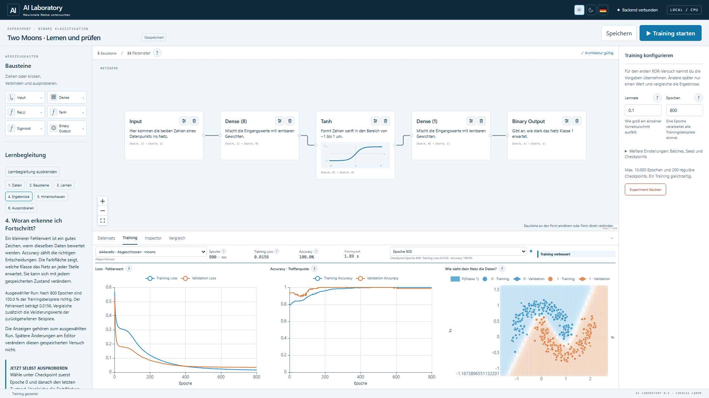
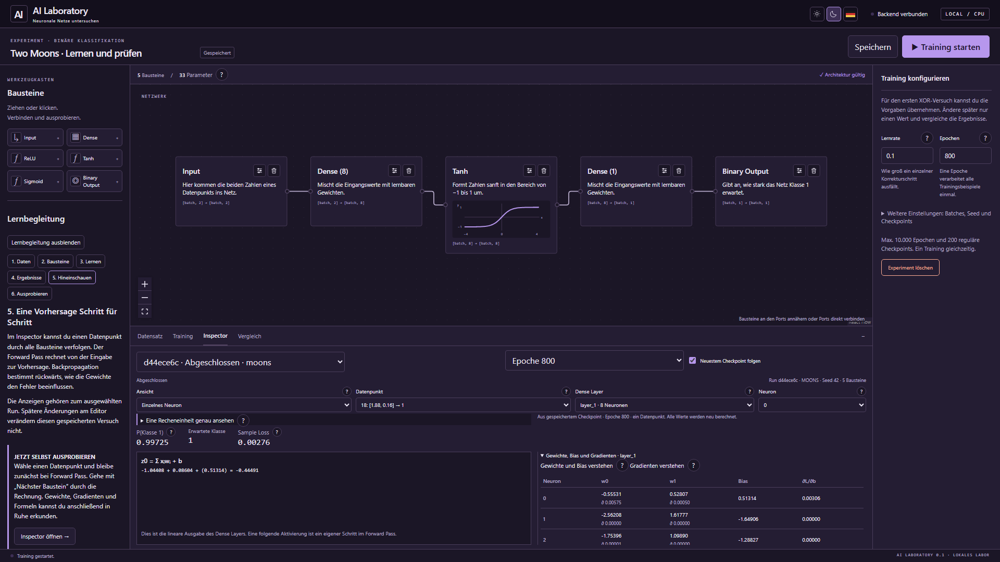

# AI Laboratory

[Deutsch](README.md) | **English (UK)**

[](https://github.com/DaniWunderlich/AI-Laboratory/actions/workflows/ci.yml)
[](https://github.com/DaniWunderlich/AI-Laboratory/releases/latest)
[](backend/pyproject.toml)
[](frontend/package.json)
[](compose.yaml)

A local learning laboratory for building, training and exploring small neural
networks. Models perform real calculations with PyTorch on the CPU. The interface
and contextual help are available in German and English, with light and dark modes.

## A look inside

**Training in light mode:** A Two Moons network showing training and validation
progress alongside the learned decision boundary.



**Inspector in dark mode:** Follow a single neuron's calculation through its
inputs, weights, bias and gradients.



## Try it on Windows and Linux

You need Git and Docker with the Compose plugin (`docker compose`). On Windows,
use Docker Desktop with Linux containers; on Linux, use Docker Engine with the
Compose plugin or Docker Desktop. Running the application in Docker does not
require separate Python or Node installations, and no GPU is needed.

Run these commands in a terminal. They work in both PowerShell and Bash:

```sh
git clone https://github.com/DaniWunderlich/AI-Laboratory.git
cd AI-Laboratory
docker compose up -d --build --wait
```

Then open **[http://127.0.0.1:18400](http://127.0.0.1:18400)**. The first build
downloads images and packages and may take a few minutes. No cloud services are
needed to run the application. It is designed for local, single-user use and is
only accessible through the loopback address.

## Your first experiment

1. Start with the **XOR template**. The learning guide and question-mark buttons
   explain the data, building blocks and settings.
2. Click **Start training**. Loss, accuracy and the decision boundary show its
   progress. The template uses 300 epochs; XOR evaluates only four training
   points, with no separate validation data.
3. Use **Checkpoint** to compare epoch 0 with the final state. The **Inspector**
   lets you explore calculations, weights and gradients. The demonstrated SGD
   step does not change the saved state.
4. Change a setting, train again and compare runs under **Compare**. Each run
   retains its original settings.

Other datasets include **Two Moons** and **Circles**, with separate training and
validation data. Add building blocks by clicking or dragging and dropping;
compatible ports connect when brought close together and released. Settings and
delete controls are on the cards themselves. Saved experiments appear on the
left. Use the small icons in the header to choose the language and colour mode.

## Running the application and storing data

These commands work in the project directory on both operating systems:

```sh
docker compose ps                       # Status
docker compose logs --tail 100           # Logs
docker compose stop                     # Stop
docker compose up -d --build --wait      # Start or rebuild changed code
```

To use a different port, copy `.env.example` to `.env` and change `LAB_PORT`.
After an interface update, reload with **Ctrl+F5** if needed.

Experiments, runs and checkpoints are stored in the `laboratory_data` Docker
volume and survive restarts and rebuilds. **`docker compose down --volumes`
deletes this data.** Stopping the application interrupts any active training.
Deleting an experiment removes its database records; weight files already saved
in the volume remain there.

## Scope and development

The application supports linear networks with two input features and one binary
output: Input, Dense, ReLU, Tanh, Sigmoid and Binary Output. The output requires a
single logit, for example from Dense(1); Sigmoid directly before it is not allowed.
Training uses SGD and `BCEWithLogitsLoss`.

Default limits: 6 hidden Dense layers, 64 neurons per layer, 5,000 parameters,
10,000 data points, 10,000 epochs and one active training run. Up to 200 regular
checkpoints are saved, plus the initial and final states. The active epoch,
data-point and checkpoint limits are available from `/api/v1/capabilities`.

Stack: React/TypeScript, Vite, React Flow, ECharts, FastAPI, PyTorch and SQLite.
The Dockerfiles pin Python 3.12.11, Node 22.14.0 and uv 0.12.18; dependencies are
pinned through lockfiles.
The [API documentation](http://127.0.0.1:18400/api/docs) is available while the
application is running, with a readiness check at `/healthz/ready`.

[GitHub Actions](https://github.com/DaniWunderlich/AI-Laboratory/actions/workflows/ci.yml)
checks backend lint and tests, plus frontend lint, TypeScript, tests and the
production build, on pull requests and changes to `main`. The status badge shows
the result on `main`; browser tests are run separately.

The same lint, test and build checks run locally in separate, short-lived
containers. From the project directory:

```sh
docker compose -f compose.test.yaml run --rm --build backend-tests
docker compose -f compose.test.yaml run --rm --build frontend-tests
docker compose -f compose.test.yaml down --remove-orphans
```

On Windows, [scripts/test.ps1](scripts/test.ps1) runs these steps for you.
[scripts/test-e2e.ps1](scripts/test-e2e.ps1) runs browser tests on port 18401 with
its own test volume. This requires local Node, the frontend packages
(`npm.cmd ci` in `frontend/`) and Chromium
(`npm.cmd exec playwright -- install chromium`).
