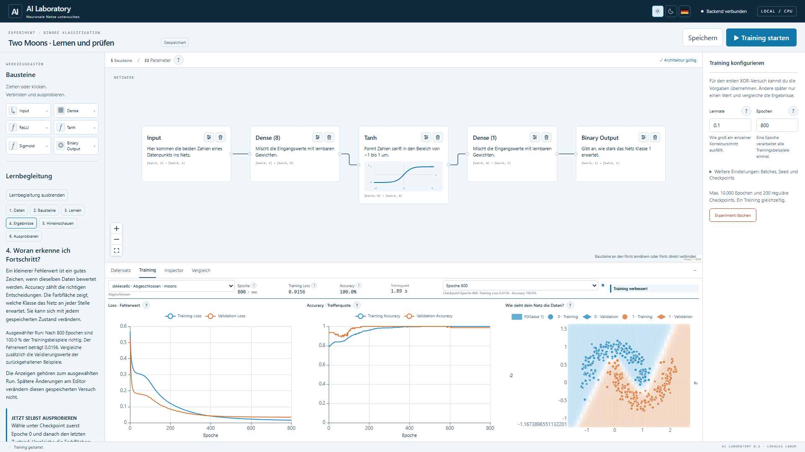
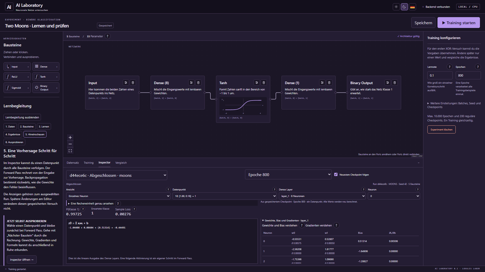

# AI Laboratory

Ein lokales Lernlabor zum Bauen, Trainieren und Untersuchen kleiner neuronaler
Netze. Die Modelle rechnen tatsächlich mit PyTorch auf der CPU. Oberfläche und
Kontexthilfen sind auf Deutsch und Englisch verfügbar, mit hellem und dunklem Modus.

## Einblicke

**Training im hellen Modus:** Ein Two-Moons-Netz mit Trainings- und
Validierungsverlauf sowie der gelernten Entscheidungsfläche.



**Inspector im dunklen Modus:** Die Rechnung eines einzelnen Neurons mit
Eingaben, Gewichten, Bias und Gradienten nachvollziehen.



## Ausprobieren unter Windows und Linux

Benötigt werden Git und Docker mit dem Compose-Plugin (`docker compose`). Unter
Windows Docker Desktop mit Linux-Containern verwenden; unter Linux funktionieren
Docker Engine mit Compose-Plugin oder Docker Desktop. Python und Node müssen für
den Docker-Betrieb nicht separat installiert werden; eine GPU ist nicht nötig.

Im Terminal ausführen – die Befehle sind für PowerShell und Bash identisch:

```sh
git clone https://github.com/DaniWunderlich/AI-Laboratory.git
cd AI-Laboratory
docker compose up -d --build --wait
```

Danach **[http://127.0.0.1:18400](http://127.0.0.1:18400)** öffnen. Der erste Build
lädt Images und Pakete und kann einige Minuten dauern. Für den Betrieb werden
keine Cloud-Dienste benötigt. Die Anwendung ist für lokale Einzelnutzung gedacht
und ausschließlich über die Loopback-Adresse erreichbar.

## Ein erstes Experiment

1. Mit der vorbereiteten **XOR-Vorlage** beginnen. Die Lernbegleitung und die
   Fragezeichen erklären Daten, Bausteine und Einstellungen.
2. **Training starten** anklicken. Loss, Accuracy und Entscheidungsfläche zeigen
   den Verlauf. Die Vorlage nutzt 300 Epochen; XOR bewertet nur vier
   Trainingspunkte, keine getrennten Validierungsdaten.
3. Über **Checkpoint** Epoche 0 mit dem Endzustand vergleichen. Im **Inspector**
   lassen sich Rechenschritte, Gewichte und Gradienten nachvollziehen. Der
   demonstrierte SGD-Schritt verändert den gespeicherten Zustand nicht.
4. Eine Einstellung ändern, erneut trainieren und die Runs unter **Vergleich**
   gegenüberstellen. Jeder Run behält seine ursprünglichen Einstellungen.

Weitere Datensätze sind **Two Moons** und **Circles** mit getrennten Trainings- und
Validierungsdaten. Bausteine werden per Klick oder Drag-and-drop ergänzt; passende
Ports verbinden sich beim Annähern und Loslassen. Einstellungen und Papierkorb
stehen direkt auf den Karten. Gespeicherte Experimente findest du links.
Sprache und Farbmodus wählst du über die kleinen Symbole im Header.

## Betrieb und Daten

Diese Befehle im Projektordner funktionieren unter beiden Betriebssystemen:

```sh
docker compose ps                       # Status
docker compose logs --tail 100           # Protokolle
docker compose stop                     # Beenden
docker compose up -d --build --wait      # Starten oder geänderten Code neu bauen
```

Ein anderer Port lässt sich einstellen, indem du `.env.example` als `.env`
kopierst und `LAB_PORT` änderst. Nach einem Oberflächenupdate bei Bedarf mit
**Strg+F5** neu laden.

Experimente, Runs und Checkpoints liegen im Docker-Volume `laboratory_data` und
bleiben bei Neustarts und Neubauten erhalten. **`docker compose down --volumes`
löscht diese Daten.** Laufende Trainings werden beim Beenden unterbrochen.
Das Löschen eines Experiments entfernt seine Datenbankeinträge; bereits abgelegte
Gewichtsdateien bleiben im Volume erhalten.

## Umfang und Entwicklung

Unterstützt werden unverzweigte Netze mit zwei Eingabewerten und einem binären
Ausgang: Input, Dense, ReLU, Tanh, Sigmoid und Binary Output. Der Output benötigt
einen Logit, etwa aus Dense(1); Sigmoid direkt davor ist nicht erlaubt. Trainiert wird mit
SGD und `BCEWithLogitsLoss`.

Standardgrenzen: 6 versteckte Dense-Schichten, 64 Neuronen je Schicht,
5.000 Parameter, 10.000 Datenpunkte, 10.000 Epochen und ein aktiver Trainingslauf.
Bis zu 200 reguläre Checkpoints plus Anfangs- und Endzustand werden gespeichert.
Die aktiven Epochen-, Punkt- und Checkpointgrenzen liefert `/api/v1/capabilities`.

Stack: React/TypeScript, Vite, React Flow, ECharts, FastAPI, PyTorch und SQLite.
Die Dockerfiles legen Python 3.12.11, Node 22.14.0 und uv 0.12.18 fest;
Abhängigkeiten sind über Lockdateien fixiert.
Die [API-Dokumentation](http://127.0.0.1:18400/api/docs) ist bei laufender Anwendung
verfügbar, die Bereitschaftsprüfung unter `/healthz/ready`.

Lint und Tests laufen in separaten, kurzlebigen Containern. Im Projektordner:

```sh
docker compose -f compose.test.yaml run --rm --build backend-tests
docker compose -f compose.test.yaml run --rm --build frontend-tests
docker compose -f compose.test.yaml down --remove-orphans
```

Unter Windows übernimmt alternativ [scripts/test.ps1](scripts/test.ps1) diese
Schritte. [scripts/test-e2e.ps1](scripts/test-e2e.ps1) führt die Browsertests auf
Port 18401 mit eigenem Testvolume aus; dafür werden lokal Node, die Frontendpakete
(`npm.cmd ci` in `frontend/`) und Chromium (`npm.cmd exec playwright -- install chromium`)
benötigt.

Lokale Projektanweisungen gehören nach `doc/AGENTS.md`. Der Ordner `doc/` mit
Planungsunterlagen und Arbeitsnotizen sowie Dateien namens `AGENTS.md` sind
aus Git ausgeschlossen und in einem frischen Clone nicht enthalten.
